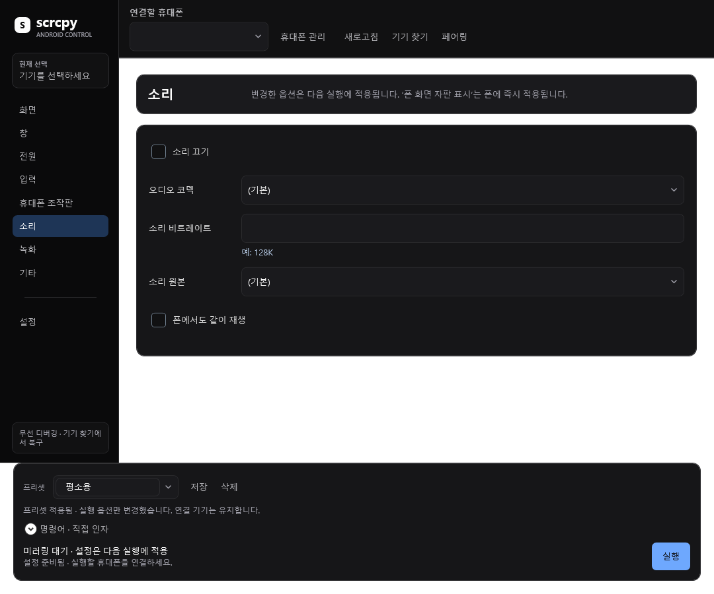
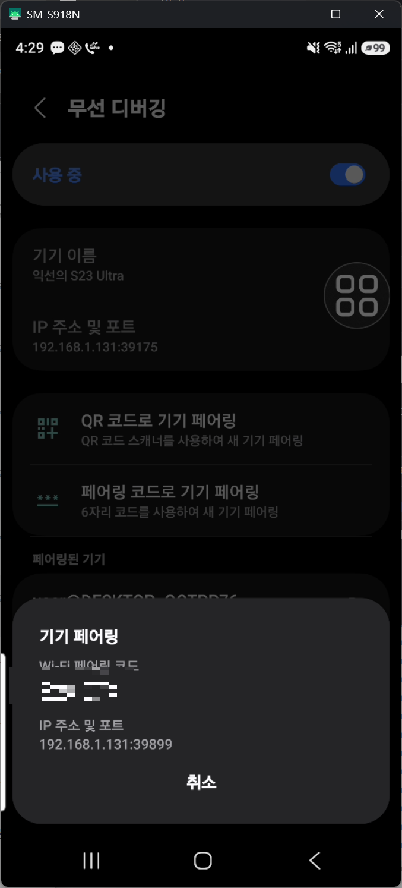
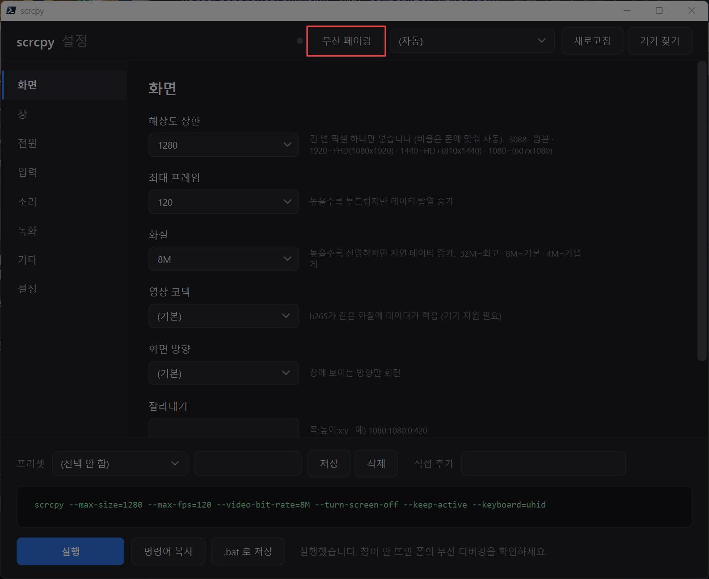

# scrcpy 설정 GUI

Windows에서 **안드로이드 폰을 PC 화면으로 조작**할 때 쓰는 [scrcpy](https://github.com/Genymobile/scrcpy)의 독립 WPF 설정 앱입니다.
scrcpy는 옵션이 100개가 넘는데 전부 명령줄로 넣어야 해서, 그걸 화면에서 고르게 만든 것입니다.

scrcpy 자체를 대체하지 않습니다. **실행 옵션·연결 상태를 관리하고, 미러링 창 밖의 조작 버튼을 제공**합니다.

> 게시된 릴리스: **v0.3.0** · 아래 설명은 2026-10-29 `main` 개발본 기준입니다. 변경 이력은 [CHANGELOG.md](CHANGELOG.md)를 참고하세요.



왼쪽에서 범주를 고르고, 하단의 **명령어 · 직접 인자**를 펼쳐 실행될 명령을 확인합니다.
위 이미지는 실제 기기 정보 없이 생성한 WPF 테스트 렌더링입니다.

## 화면 구성

- 좌측 사이드바에서 화면·창·전원·입력 등 옵션 범주를 고릅니다.
- 상단의 **휴대폰 관리**에서 여러 기기를 등록하고, 표시 이름·모델명·기본 기기를 정합니다. 목록에는 현재 연결 상태와 최근 사용 날짜가 표시됩니다.
- 설정 화면 상단은 **범주 이름 / 설명**의 2열 테두리 카드입니다.
- 프리셋·직접 인자·명령어·실행 버튼은 좌측 사이드바까지 이어지는 창 전체 폭 하단 도크에 있습니다.
- **직접 인자 추가**는 별도 모달에서 입력합니다. 값은 프리셋과 마지막 사용 설정에 함께 저장됩니다.
- 명령어 미리보기는 최대 3줄로 줄바꿈해 보여 줍니다. 더 긴 명령어는 세로 스크롤로 확인할 수 있습니다.
- 창 제목 표시줄과 배포 실행 파일에는 scrcpy 설정 앱 아이콘이 표시됩니다.

### 실행·설정 상태와 접근성

- 상단 연결 동작은 좁은 창에서 줄바꿈하며, 일반 옵션은 좁을 때 라벨 위·입력 아래로, 넓을 때 가로 2열로 표시합니다. 체크박스는 라벨을 포함한 44 DIP 이상의 영역으로 누르며 입력 필드에 접근성 이름을 제공합니다.
- 명령어·직접 인자는 접이식 영역에 모았습니다. 미러링 상태와 연결·저장 작업 상태를 구분합니다. 옵션 변경은 **다음 실행**에 적용되며, 폰 화면 자판 토글만 선택한 휴대폰에 즉시 적용합니다.
- 실행 직후에는 ‘시작 중’으로 표시하고 영상 창이 확인돼야 ‘미러링 실행 중’으로 바뀝니다. 조기 종료 시 종료 코드와 최근 출력으로 원인을 표시합니다. 백그라운드 녹화처럼 영상을 표시하지 않는 세션은 별도로 표시합니다. GUI 종료가 미러링 프로세스를 강제 종료하지는 않습니다.
- 안구마우스에서 화면 탈출 수단이 없는 캡처형 마우스 모드(`uhid`, `aoa`, `-M`, `--otg`, `--relative-mouse`)는 최종 실행 인자에서 검사해 실행을 보류하고 `sdk`를 안내합니다. 키보드의 `uhid`는 그대로 사용할 수 있습니다.
- 프리셋은 **실행 옵션만** 저장합니다. 기기 선택은 상단에서 별도로 유지하며, 프리셋 적용 전에 세션 옵션을 기본값으로 초기화해 이전 프리셋 값이 남지 않게 합니다. 직접 인자는 Windows 따옴표 규칙으로 해석하고 닫히지 않은 따옴표는 적용 전에 알립니다.
- 마지막으로 고른 프리셋 이름은 마지막 사용 설정에 함께 기록해 재실행 후에도 선택을 유지합니다. 재시작할 때 프리셋 원본을 다시 적용하지 않으므로 선택 후 추가 조정한 값도 보존합니다. 삭제된 프리셋은 ‘선택 안 함’으로 표시하며 마지막 옵션은 유지합니다.
- 설정은 임시 파일 작성 후 교체합니다. 저장 실패를 화면에 남기며, 프리셋은 파일 기록이 성공한 뒤에만 메모리에서도 확정합니다. 실행 파일의 유효한 수동 지정 경로는 자동 탐지보다 우선합니다.
- 연결 작업에 ‘검색 취소’를 제공하며, ADB 명령은 출력 수집까지 기본 12초, 페어링은 30초로 제한합니다. 취소·시간 초과는 이번 클라이언트 명령만 종료하며 공유 ADB 서버를 종료하지 않습니다. 폰 설정 조회 실패는 꺼짐이 아닌 미확인으로 표시합니다.

---

## 필요한 것

| | 최소 | 비고 |
|---|---|---|
| Windows | 10 / 11 | |
| .NET | 없음 (배포본) | `app\ScrcpyGui.exe`는 .NET 런타임을 포함합니다. 소스에서 배포본을 만들 때만 .NET 8 SDK가 필요합니다 |
| scrcpy | 공식 최신 Windows 64비트 ZIP | Android 16 폰이면 **4.0 이상 필요** (그 미만은 크래시) |
| adb | platform-tools | scrcpy 공식 배포판에 대부분 같이 들어 있습니다 |
| 폰 | Android 5.0+ | 무선으로 쓰려면 **Android 11+** |

## 실행

배포본에서는 `app\ScrcpyGui.exe`를 직접 실행하세요. 이 앱은 콘솔·PowerShell 프로세스에 매달리지 않으며,
설정 창을 닫은 뒤에도 이미 실행한 scrcpy 미러링 창은 유지됩니다.

소스 저장소에서 처음 만들 때는 다음을 한 번 실행합니다.

```powershell
.\publish-wpf.ps1
```

`scrcpy-gui.bat`와 `scrcpy_run.bat`는 기존 바로가기 호환용입니다. 배포본이 없을 때만 위 WPF 앱을 빌드한 뒤
`app\ScrcpyGui.exe`를 엽니다. PowerShell 7은 더 이상 실행 요구사항이 아닙니다.

`scrcpy.exe`와 `adb.exe`는 **자동으로 찾습니다.** 찾는 순서는 다음과 같습니다.

1. `설정` 탭에서 직접 지정해 저장한 경로
2. 설정 파일이 있는 폴더의 실행 파일
3. `C:\app` 아래의 `scrcpy*\scrcpy.exe`와 기본 adb 경로

유효한 수동 경로가 없고 여러 자동 탐지 후보가 있으면 경로 이름의 버전 정보를 기준으로 후보를 고릅니다. 찾지 못하면 앱은 계속 열려 있고,
왼쪽 `설정` 탭의 **찾아보기**에서 `scrcpy.exe`와 `adb.exe` 위치를 직접 지정할 수 있습니다.
지정한 경로는 `scrcpy-gui-config.json`에 저장됩니다.

---

## 처음 한 번만: 무선으로 연결하기 (Android 11+)

USB 케이블 없이 쓰려면 최초 1회 페어링이 필요합니다. **이 페어링은 폰에 저장돼서 재부팅해도 유지됩니다.**

1. 폰: `설정` → `개발자 옵션` → **무선 디버깅** 켜기
2. `무선 디버깅` 글자를 눌러 들어가서 → **`페어링 코드로 기기 페어링`**
3. GUI 상단의 **무선 페어링**을 누르고 팝업에 뜬 `IP:포트`와 6자리 코드를 입력
4. 목록에 기기가 보이면 **실행**을 누릅니다. 페어링 코드는 앱에 저장하지 않습니다.




scrcpy 공식 ZIP을 설치한 뒤에는 `설정` 탭에서 `scrcpy.exe` 또는 `adb.exe`를 지정할 수 있습니다.
무선 디버깅 연결에는 별도 USB 연결이 필요하지 않습니다.

> ⚠️ `adb tcpip 5555` 방식은 쓰지 마세요. **전환 자체에 USB 연결이 필요하고**, Wi-Fi가 끊기거나
> 폰을 재부팅하면 풀려서 다시 케이블을 꽂아야 합니다. 무선 디버깅 페어링에는 그 문제가 없습니다.
>
> ⚠️ 무선 디버깅은 **재접속마다 포트가 바뀝니다.** `IP:5555` 를 고정해두는 방식은 동작하지 않습니다.
>
> ⚠️ 폰을 재부팅하면 무선 디버깅 **토글이 꺼집니다**(기기에 따라 다름). 퀵설정 타일에 추가해두면 1탭으로 켤 수 있습니다.
>
> ⚠️ 페어링이 `protocol fault (couldn't read status message)` 로 실패하면 adb 문제가 아니라
> **PC의 Windows 네트워크 프로필이 "공용"** 이라 방화벽이 폰과의 로컬 연결을 막고 있는 경우가 흔합니다
> (특히 재부팅 직후). `설정` → `네트워크 및 인터넷` → 지금 연결된 네트워크 → 프로필 유형을
> **"개인"** 으로 바꾸고 다시 시도하세요.

---

## 다시 연결할 때: 기기 찾기

폰이 목록에서 사라졌으면 상단 **기기 찾기**를 한 번 누르세요. 폰을 집어 들지 않고 PC에서 복구합니다.

1. 폰이 스스로 붙는지 몇 초 기다립니다
2. 안 되면 같은 Wi-Fi에서 폰의 주소를 직접 찾아, **응답하는 주소에만** 연결합니다
3. 실패하면 폰의 무선 디버깅·동일 Wi-Fi·페어링 여부를 안내합니다. 검색 중에는 **검색 취소**로 중단할 수 있습니다.

진행 단계와 실패 이유는 하단 상태줄에 표시됩니다. **기기 찾기는 공유 ADB 서버를 재시작하지 않으므로 기존 미러링 연결을 강제로 끊지 않습니다.** 복구 시간은 현재 연결 상태에 따라 다르며 실제 폰에서의 확인은 별도로 필요합니다.

전에 연결했던 기기는 꺼져 있어도 **`(오프라인)`** 으로 목록에 남습니다. 기존에는 목록에서 사라져
다시 고를 수조차 없었습니다. 오프라인 기기를 고른 채 **실행**을 누르면 막고 기기 찾기를 안내합니다.

---

## 한글이 입력되지 않을 때

scrcpy 기본 모드는 키 코드만 보내서 폰의 입력기(IME)를 거치지 않습니다. 그래서 한글이 안 됩니다.

1. `입력` 탭 → **키보드 방식 = `uhid`** (기본값으로 설정돼 있음)
2. **폰 기본 키보드를 확인하세요.** 물리 키보드 처리가 부실한 키보드 앱이 있습니다.
   삼성 폰이면 **삼성 키보드**를 권장합니다.
   ```
   adb shell ime list -s                                   # 설치된 키보드 목록
   adb shell ime set <위 목록에서 고른 것>                    # 기본 키보드 변경
   ```
3. 한/영 전환은 **입력칸에 커서를 놓은 상태에서** `Shift+Space` (또는 `Ctrl+Space`, `Alt+Shift`).
   입력칸 밖에서 누르면 아무 반응이 없습니다 — 고장이 아닙니다.

**증상으로 원인 찾기**: 숫자는 들어가는데 **알파벳만 안 들어가면** 키보드 앱 문제입니다.
숫자는 IME를 거치지 않고 들어가고 알파벳만 IME가 가로채기 때문입니다.

물리 키보드를 쓸 때 폰 화면 자판이 뜨는 게 거슬리면 → `입력` 탭의 **폰 화면 자판 표시** 토글을 끄세요
(폰 설정을 직접 바꿉니다. 바꾸기 전에 확인창이 뜨며, 되돌리려면 다시 켜면 됩니다).

`입력` 탭에서 **마우스 방식 = `uhid` 또는 `aoa`**를 고르면 마우스가 창에 캡처될 수 있습니다.
빠져나오려면 **`Alt` 또는 Windows 키**를 누르세요. 다시 누르면 재캡처됩니다.

---

## 폰 화면을 끄고 PC로 쓰기

`전원` 탭의 **화면 끄고 PC로 사용**만 켜면 됩니다. GUI가
`--turn-screen-off --keep-active`를 함께 넣어, 폰의 물리 화면은 끄고 PC 제어는 유지합니다.

- 이 모드에서는 **충전 중 활성 유지**와 **화면 자동 꺼짐 시간**을 자동으로 해제·비활성화합니다.
  모드를 끄면 이전 선택을 되돌립니다.
- 조작이 필요한 기능이므로 `입력` 탭의 **보기 전용**은 함께 선택할 수 없습니다.
  직접 추가 인자에 `--no-control` 또는 `-n`을 넣은 경우에도 실행·배치 파일 생성을 막습니다.
- 폰의 **물리 전원 버튼**을 누르면 화면이 다시 켜집니다.

---

## 화면이 너무 길쭉할 때

요즘 폰은 20:9 안팎이라 가로 모니터에 세로로 띄우면 매우 깁니다. **폰 화면 그대로라 정상입니다.**

가로로 넓게 쓰고 싶으면 `화면` 탭 → **가로 화면 (16:9)** 에서 `1920x1080` 을 고르세요.
폰 안에 **PC 모니터 비율의 화면을 새로 만들어** 띄웁니다. 폰 본체 화면과 독립적으로 돌아갑니다.

---

## 설정이 저장되는 방식

### 휴대폰 외부 조작판

왼쪽 **휴대폰 조작판**에서 열린 scrcpy 영상 창을 찾습니다. **창이 하나면 자동 선택**하며 여러 개일 때만 선택 목록을 표시합니다. 설정 GUI와 콘솔은 대상 목록에서 제외됩니다. 앱은 선택한 창의 실제 실행 인자를 읽어 `--shortcut-mod`를 적용하며, 보기 전용·캡처형 마우스(`uhid`, `aoa`, `-M`)·확인할 수 없는 실행 옵션에서는 조작을 보류합니다. 스크롤은 SDK 마우스 모드를 사용합니다.

1. 미러링 창을 열고 **휴대폰 조작판**으로 들어갑니다. 창이 하나면 자동 선택하므로 **▶ 사용하기**만 누르면 됩니다. 화면을 보는 동안 3초마다 목록을 갱신하며 **다시 찾기**로 즉시 조회할 수도 있습니다. ADB 응답을 기다리지 않고 목록부터 조회합니다. 같은 창이 남아 있으면 선택·영상 지점·사용 상태를 유지합니다. 여러 창이 있으면 현재 선택을 유지하며 대상을 임의로 바꾸지 않습니다. 앱을 다시 시작했을 때 열린 대상이 이미 있으면 조작판 설정 화면을 먼저 보여 줍니다. 대상 자동 선택이 입력 자동 시작을 뜻하지는 않습니다.
2. **배치·크기**에서 미리보기를 보며 나눠 놓기(A) / 한 줄로 놓기(B), 왼쪽·오른쪽, 높이와 크기를 고릅니다. **사용**에서 바라보기(드웰) 또는 클릭을 고르고 **속도·스크롤**에서 처음 바라보는 시간과 반복 속도를 조절합니다.
3. **▶ 사용하기**를 누릅니다. 기본 스크롤 지점은 화면 가운데이므로 별도 지정 없이 시작할 수 있습니다. 사용 중 배치·응시 시간을 바꿔도 적용 후 계속 사용합니다. 직접 **일시 정지**했다면 사용하기를 눌러야 재개됩니다.
4. 댓글 등 다른 위치를 스크롤하거나 검은 여백을 제외하려면 **고급 → 스크롤할 위치를 직접 지정하기**에서 영상 왼쪽 위 → 오른쪽 아래 → 지점을 차례로 고릅니다. 지정 중 클릭은 Android에 보내지 않습니다.

설정은 **사용 / 배치·크기 / 글자·색상 / 드웰 피드백 / 속도·스크롤 / 고급** 탭으로 나눕니다. 조작판 화면에서는 미러링 실행용 기기·프리셋·명령어 영역을 접어 이중 조작 영역을 없앱니다. 숫자는 직접 입력하거나 충분한 크기의 −/+ 버튼으로 바꾸며 슬라이더를 중복 표시하지 않습니다. 실행 상태와 사용·정지 버튼은 아래에 고정하고 측정 세부 정보는 접어 둡니다.

| 설정 위치 | 조절 항목 |
|---|---|
| 배치·크기 | 창과의 여백 0–160 DIP, 버튼 사이 0–80 DIP, 묶음 사이 0–120 DIP, 고정 높이 32–200 DIP, 가로/세로 비율 50–250%, 창 너비에 비례하는 높이 5–50% |
| 글자·색상 | 글자 크기 8–48 DIP, 글자·배경·테두리 색, 모서리 둥글기, 불투명도 |
| 드웰 피드백 | 막대·링·위로 채우기·숨김, 게이지 색과 두께, 완료 시 배경색 표시 여부·색·시간 |

크기·여백·모양은 정지·설정을 포함한 7개 버튼에 적용합니다. 고정 크기는 창을 줄여도 유지하고, 비례 크기는 창 너비에 따라 바뀌며 높이 32–200 DIP 안으로 제한합니다. 가로 비율 150%는 높이 72 DIP일 때 너비 108 DIP를 뜻합니다. 색상은 이름 목록과 `#RRGGBB` 입력을 지원합니다. 실제 버튼과 미리보기가 같은 렌더러를 사용하며, 피드백 미리보기는 휴대폰 입력 없이 자동 재생합니다. 스크롤 반복 대기도 선택한 게이지로 표시합니다.

사용하기를 누르면 선택한 미러링 창의 포커스를 확인합니다. 이후 스크롤의 기본 가림 정책은 **중지**이며 지점이 드러나 있어야 합니다. 고급 설정에서 **다른 창을 보고 있어도 스크롤할 때 휴대폰 창을 앞으로 가져오기**를 켜면 전송 전에 포커스 확보를 시도하고, 실패하면 보내지 않습니다.

지원 배치는 다음과 같습니다. 좌우를 바꿔도 버튼 의미와 위아래 순서는 같습니다.

| 배치 | 구성 | 조합 |
|---|---|---|
| A 분리형 | 하단 뒤로·홈·최근 앱 + 좌/우 측면 이전·다음 내용, 측면 위/가운데/아래 정렬 | 6 |
| B 통합형 | 좌/우 측면 5버튼, 위/가운데/아래 정렬, 스크롤 묶음을 핵심 3버튼 위/아래에 배치 | 12 |

핵심 3버튼은 한 번씩 scrcpy 단축키를 보내며 커서를 이동하지 않습니다. 스크롤은 논리 포인터를 남기고 실제 커서만 지정 지점으로 이동 → 휠 → 최신 사용자 위치로 복귀합니다. 외부 입력 보조 도구의 합성 이동도 사용자 입력으로 관찰합니다. 응시 반복과 클릭 유지 반복은 별도 설정이며, 반복 간격은 **이전 왕복 완료 뒤**부터 잽니다. 이탈·정지·대상 변경 시 대기 명령을 재생하지 않습니다.

스크롤 기본 전송은 new-alt의 최적화된 원격 포인터와 같은 **이동 → 휠 → 복귀를 한 SendInput 묶음으로 전송**하는 방식입니다. 첫 응시 300ms, 복귀 후 안정화 20ms, 다음 반복 대기 300ms, 한 번에 휠 1칸이 기본입니다. 반복 대기 합계는 320ms이며 실제 주기는 Windows 처리·타이머 지연을 포함합니다. **속도·스크롤**에서 첫 응시, 반복 대기, 이동량, 안정화를 숫자 입력·−/+로 조절하고 **new-alt 기본값 적용**으로 되돌릴 수 있습니다. **단계별 왕복**을 선택하면 도착 후 휠 전 대기와 휠 후 복귀 전 대기도 각각 조절합니다. 시간은 0ms까지 허용하며 0ms는 추가 대기를 생략한다는 뜻입니다. 기존 설정의 기본 속도(700/450ms)는 처음 불러올 때 300/300ms로 갱신하며 개별 조정값과 배치·대상·스크롤 지점은 보존합니다.

정지·설정 2개는 휴대폰 창에 마우스가 올라오면 **제목표시줄 바로 위·왼쪽 정렬**로 나타납니다. 휴대폰 영상 안이나 바탕화면 모서리에 놓지 않습니다. 정지 상태에서는 같은 버튼이 **사용 시작**으로 바뀝니다. 설정 버튼은 최소화된 GUI를 이전 일반/최대화 상태로 복원합니다.

다른 창이 미러링 화면을 가리면 조작판 전체와 논리 포인터를 숨기고 진행 중 반복을 취소합니다. 휴대폰 창이 다시 드러나면 원래 배치로 표시하며 새 응시부터 시작합니다. 단순히 다른 앱이 활성 상태인 것과 실제로 화면이 가려진 것을 구분합니다. 자체 조작판·논리 포인터와 실제 클릭을 통과시키는 투명 표면은 가림으로 세지 않습니다.

조작판을 사용하는 동안 설정 창의 X를 누르면 창만 최소화되고 버튼은 계속 동작합니다. **조작판 끄기** 후 설정 창을 닫으면 완전히 종료합니다. 새로고침 후 대상 선택이 사라지면 이전 조작판 창을 모두 숨깁니다. 창을 움직이거나 크기를 바꿔도 동일한 미러링 창을 따라가며, 공간이 부족하면 버튼 크기를 유지한 채 휴대폰 창과 버튼을 함께 화면 안으로 옮깁니다. 이동만으로 부족하면 제목표시줄을 제외한 영상 비율을 유지하며 휴대폰 창 크기를 줄입니다. 사용자가 창을 드래그하는 동안에는 강제로 위치를 바꾸지 않습니다. 고급 설정의 **창과 버튼을 화면 안으로 옮기기**로 직접 정리할 수도 있습니다.

`scrcpy-gui-remote.json`은 기존 프리셋·기기 설정과 분리됩니다. A/B 각각의 마지막 좌우·정렬과 B의 묶음 순서, 모양·색·피드백, 영상 영역·상대 지점을 저장합니다. 기존 파일을 처음 갱신할 때 `.bak`을 보존합니다. 재시작 후 HWND를 재사용하지 않으며 현재 열린 창을 다시 찾아 하나면 자동 선택합니다. 저장된 창 제목과 영상 비율이 맞으면 기존 지점을 사용하고, 다른 창이면 가운데에서 시작합니다.

창 이동·리사이즈는 좌표를 다시 계산합니다. 기본 가운데 지점은 크기를 바꿔도 유지합니다. 직접 지정한 지점이 있고 클라이언트 비율이 2% 이상 바뀌면 조작을 멈추고 재지정을 안내합니다. **고정된 창 내부에서만 발생하는 회전·영상 여백 변경은 자동 검출하지 못하므로 영역을 다시 지정해야 합니다.** 혼합 DPI·회전·가림과 실제 안구마우스 50회 왕복의 수락 검수는 별도로 필요합니다. 상태의 횟수·시간은 명령 제출/왕복 측정이며 Android 화면 반응을 판정하지 않습니다.

소스 검증:

```powershell
dotnet build src/ScrcpyGui/ScrcpyGui.csproj -c Release
dotnet run --project tests/RemoteControls.Tests -c Release
```

테스트는 배치 18조합과 100/125/150/200% 좌표, 설정 보존, 활성화 시점·단발·반복·이탈, 논리 포인터 계산, 실행 옵션 해석과 WPF 화면 구성을 검증합니다. 결합 옵션(`-fn`, `-fM`)과 옵션 값의 구분, 응시/클릭 유지 반복의 독립 조합, 왕복 중 논리 위치의 가림 검사도 포함합니다. 실제 릴레이의 취소·복귀·클릭 해제 경로는 전역 훅 없이 입력 출력을 기록으로 대체해 검증합니다. 대상 선택 소실은 비활성·화면 밖 WPF 창의 숨김과 입력 영역 해제를 확인하며, 최소화 복원은 헤드리스 창의 상태와 상태 변경 처리기를 검증합니다. `-- --render`는 WPF 설정 화면을 테스트 출력 폴더의 `remote-settings.png`로 렌더링합니다. 이 테스트는 휴대폰에 입력을 보내지 않으며 실제 안구마우스/UI 수락을 대신하지 않습니다. 표준 빌드 실행본은 `src/ScrcpyGui/bin/Release/net8.0-windows/ScrcpyGui.exe`, 배포본은 기존처럼 `publish-wpf.ps1`의 `app/ScrcpyGui.exe`입니다.

일반 GUI 회귀 검사는 실제 `MainWindow` XAML·코드를 같은 체크아웃에서 컴파일하고 임시 설정 폴더로 실행합니다. 프리셋 초기화·재시작 선택 복원·수동 경로 우선·저장 실패·Windows 인자 파싱·조기 종료·취소·상속 출력 핸들 제한 시간을 검증합니다. 같은 창을 640 → 1080 → 640 DIP로 바꿔 본문과 연결·실행 버튼의 가시 영역을 확인합니다. 테스트용 자식 프로세스 외에 실제 scrcpy·폰 입력·공유 ADB 서버를 종료하지 않습니다.

2026-10-29 기준 기본 검사 **1,746개**, 렌더링 포함 **1,752개**가 통과했습니다. 렌더링은 다음 명령으로 생성하며 `main-범주-너비.png`, `remote-settings-탭번호.png`가 테스트 출력 폴더에 저장됩니다.

```powershell
dotnet run --project tests/RemoteControls.Tests -c Release --no-restore -- --render
```

| 파일 | 무엇 | 언제 |
|---|---|---|
| `scrcpy-gui-config.json` | scrcpy·adb 실행 파일 위치, 등록 휴대폰(표시 이름·모델명·기본 기기·사용 기록) | 설정 또는 휴대폰 관리에서 바꿀 때 |
| `scrcpy-gui-presets.json` | 이름 붙여 고르는 프리셋 | `저장` 버튼을 누를 때 |
| `scrcpy-gui-last.json` | 마지막 옵션·기기·프리셋 이름 | 프리셋 선택·저장·삭제 시 및 **창을 닫을 때 자동** → 다음 실행 시 복원 |
| `scrcpy-gui-remote.json` | 외부 조작판의 배치·모양·드웰·스크롤 설정 | 조작판 설정을 바꿀 때 |

이 파일들은 설정 데이터 폴더에 생기며 실행 파일·배포 산출물과 함께 커밋하지 않습니다. 같은 이름으로 시작하는 백업·임시 파일도 제외합니다. 지우면 해당 설정이 기본값으로 돌아갑니다.

> 프리셋 선택은 즉시 기록하지만 이후 조정한 최신 옵션은 정상 종료 때 저장됩니다. 작업관리자로 강제 종료하면 최근 조정값이 저장되지 않을 수 있습니다.

## v0.3.0 변경점

- 창 제목 표시줄과 배포 실행 파일에 앱 아이콘을 추가했습니다.
- Windows에서 scrcpy 설정 앱을 더 쉽게 구분할 수 있습니다.

## v0.2.0 변경점

- .NET 런타임을 포함한 독립 WPF 앱으로 전환해 PowerShell 실행 환경 없이 설정 창을 실행할 수 있습니다.
- 여러 휴대폰을 등록·수정·제거하고, 표시 이름·모델명·대표 기본 기기를 관리할 수 있습니다.
- 선택한 기기와 연결 상태를 좌측에 표시하고, 마지막 선택 또는 자동 선택 모드를 복원합니다.
- 기기 관리 창을 다크 테마로 통일하고 긴 목록의 가로 스크롤을 제거했습니다.
- 명령어 미리보기를 최대 3줄로 표시해 스크롤바가 내용을 가리지 않게 했습니다.
- `--screen-off-timeout=500` 기본 추가를 제거했습니다. 화면 끄기는 **화면 끄고 PC로 사용** 토글을 켰을 때만 동작합니다.

---

## 옵션 추가하기

`src/ScrcpyGui/MainWindow.xaml.cs`의 `Definitions()`에 옵션 정의를 한 줄 추가하면 화면에 항목이 생깁니다.
기존 PowerShell 구현은 이전 설정 파일과의 호환·비교를 위해 남아 있지만, 기본 실행 경로는 WPF 앱입니다.

| `OptionKind` | 화면에 나오는 것 |
|---|---|
| `Text` | 입력칸 |
| `Check` | 문구 전체를 누르는 체크박스 |
| `Combo` | 목록에서 고르기 |
| `EditableCombo` | 목록 + 직접 입력 |
| `PhonePreference` | 선택한 폰 설정을 adb로 즉시 바꾸는 체크박스 (확인 후 적용, scrcpy 명령어에는 안 들어감) |
| `Path` | 실행 파일 경로 + 찾아보기 |

주요 소스는 다음과 같이 나눕니다.

| 파일 | 역할 |
|---|---|
| `MainWindow.xaml` / `MainWindow.xaml.cs` | 일반 GUI, 옵션·기기·프리셋·저장 |
| `MainWindow.Runtime.cs` | 세션 상태 감시와 연결 작업 취소 |
| `ScrcpyCommandLine.cs` | Windows 인자 파싱·인용 및 캡처 모드 판정 |
| `RemoteControls.cs` / `RemoteControls.Appearance.cs` | 조작판 상태와 설정 화면 |
| `RemoteSettings.cs` | 조작판 설정 보존과 외부 배치 계산 |
| `RemoteNative.cs` / `RemoteRelay.cs` | scrcpy 식별·Win32 출력과 드웰·왕복 처리 |
| `RemoteButtonWindow.cs` / `RemoteButtonVisual.cs` | 비활성 버튼 창과 실제·미리보기 공용 렌더러 |

---

## 라이선스·출처

**개인 사용 무료.** 개인이 비상업 목적으로 사용하는 것은 무료입니다.

회사·단체·의뢰 업무에서의 사용, 상업적 이용, 재배포·판매, 수정본 제작·배포는 제작자의 허가가 필요합니다. [ikseon@blinklabs.co.kr](mailto:ikseon@blinklabs.co.kr)로 이메일 주시면 협의합니다. 소스 코드는 참고용으로만 볼 수 있습니다.

Copyright © 2026 장익선(BlinkLabs). All rights reserved. 자세한 내용은 [LICENSE](LICENSE)(영문 원문이 우선)를 참고하세요. 2026-10-15 이전에 MIT License로 배포된 버전은 받은 당시의 조건 그대로 유지됩니다.

### 출처

- scrcpy © Genymobile — [Apache-2.0](https://github.com/Genymobile/scrcpy/blob/master/LICENSE).
  이 저장소는 scrcpy를 **포함하지 않고 실행만** 합니다. scrcpy는 따로 받아야 합니다.
